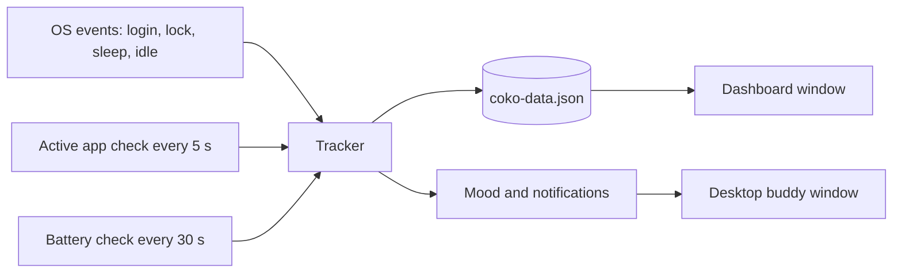

# 

A small animated *desk buddy* that keeps track of your day and nudges you to take breaks.

## 

CoKo puts a little animated character on your desktop, about the size of four desktop icons. She
keeps an eye on how you spend your time: when you log in, which apps you use, when you step away
and how your battery is doing. Click her and a *dashboard* opens beside her, styled like a game
character's status screen.

Everything stays on your own computer in a single file, `coko-data.json`. Nothing is sent anywhere.

## 

- A transparent, always-on-top buddy you can drag anywhere; she remembers where you put her
- Click her for the *dashboard*, right-click for a quick summary of today
- She reacts to what you're doing:

  | What's happening | How she reacts |
  |---|---|
  | Working in a focus app | Focused |
  | Away from the keyboard | Falls asleep |
  | Close to break time | Gets tired |
  | Low battery | Worried |
  | Critical battery | Panics |
  | Charger plugged in | Happy |
  | Daily goal reached | Excited |
  | You come back | Waves |
  | YouTube in the middle of work | Gently nudges you |

- Notifications for breaks, an hourly work summary, battery alerts and reaching your goal
- *Quests*: a small to-do list with notes, work logs and an optional mood
- A level that goes up each day you hit your goal, plus a 7-day chart

## 

| What | How it's measured |
|---|---|
| Sessions | Logging in, unlocking and waking start a session; locking, sleep and shutdown end it |
| Active app | The focused app is checked every 5 seconds and tagged as focus, distraction or neutral |
| Idle time | Time with no keyboard or mouse input; past a threshold it counts as away |
| Battery | Checked every 30 seconds, with 7 days of history |

You pick one of five types when you start, and it sets your daily goal, break interval, which apps
count as *focus*, the colour theme and what she says:

| Type | Daily goal | Break every | Focus apps (examples) |
|---|---|---|---|
| Student | 4 h | 45 min | Notion, PDF readers, Anki, Classroom |
| Developer | 6 h | 60 min | VS Code, JetBrains, terminals, GitHub |
| Freelancer | 5 h | 50 min | Figma, Adobe, DaVinci, Upwork |
| Office | 8 h | 60 min | Outlook, Teams, Excel, Jira |
| Personal | 3 h | 40 min | Notes, Kindle, Duolingo |

To change or add types, edit `src/main/profiles.js`.

## 



Everything runs in Electron's main process and is saved to one local file. The two windows only display it.

## 

<p align="center">
  
  
  
  
  
  
</p>

| Layer | Technology |
|---|---|
| Desktop app | Electron |
| Code | JavaScript, HTML, CSS |
| System data | systeminformation, Electron powerMonitor |
| Character tool (optional) | Python, Pillow, NumPy |

## 

You need [Node.js](https://nodejs.org) 18 or newer.

```bash
git clone https://github.com/Iamshi-vissa/CoKo.git
cd CoKo
npm install
npm start
```

To build an installer (`.exe` on Windows, `.dmg` on macOS, `.AppImage` or `.deb` on Linux):

```bash
npm run dist
```

An installed build starts when you log in, which is how log-ins get tracked.

Want a detailed animated character instead of the built-in one? See
[docs/CUSTOM_CHARACTER.md](docs/CUSTOM_CHARACTER.md).

## 

- Active-app detection uses built-in OS tools, so there's nothing to compile: PowerShell on Windows,
  `lsappinfo` on macOS and `xprop` on Linux. On Linux it needs X11, because Wayland doesn't let apps
  see other windows.
- On Linux the transparent buddy needs a compositing desktop, which GNOME, KDE and Cinnamon are.
- Run `COKO_DEBUG=1 npm start` to see logs in the terminal.
- To find your data file, use **Open data folder** in the tray menu.

## 

```
src/main/        app windows, tray, tracking, storage and the five types
src/renderer/    the desktop buddy (widget.*) and the dashboard (dashboard.*)
  shared/        character player, base styles and fonts
  character/     your converted animation loops, if you add a custom character
tools/           make_character.py, for custom characters
docs/            custom character guide
```

## 

Version 2 works on Windows, macOS and Linux (X11). There are no automated tests yet. Wayland support
for active-app detection is missing.

## 

MIT. See [LICENSE](LICENSE). The bundled fonts keep their own licenses in
`src/renderer/shared/fonts/`.
